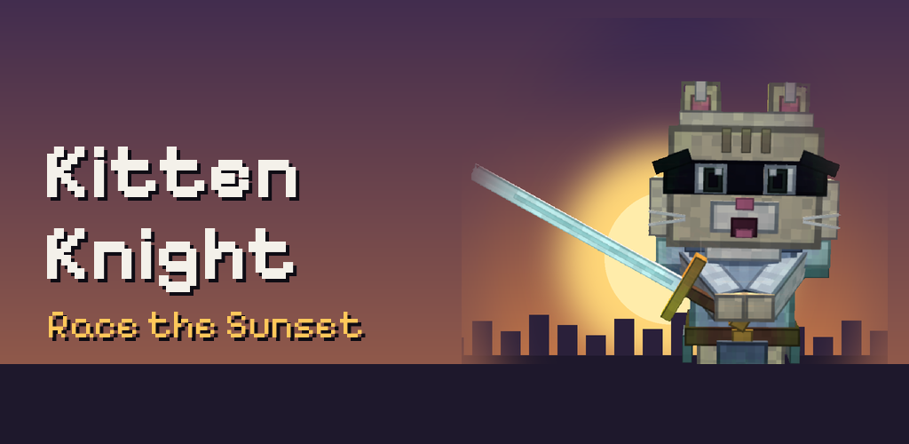

# Kitten Knight: Chase the Dawn

A voxel runner with a sword. The Dusk Lord stole the dawn and hid it behind magic gates that open only
while sunlight falls on them. Catch sparks to hold the sun in the sky, slash crows and goblins, beat the
Dusk Guardians and bring morning back to eight magical lands.

**Play in the browser:** https://sergeychere.github.io/kitten-knight/
**Privacy policy:** https://sergeychere.github.io/kitten-knight/privacy.html



One codebase, every platform:

| Platform | How it is built | Store |
|---|---|---|
| Web | `www/` as is | GitHub Pages |
| Android | Capacitor (`android/`) | Google Play |
| iPhone | Capacitor (`ios/`) | App Store |
| Linux | Electron → Snap, AppImage, .deb | Snap Store / Ubuntu App Center |
| Windows | Electron → installer + portable .exe | itch.io, Steam, Microsoft Store |
| macOS | Electron → .dmg | itch.io, Steam |

## Repository layout

```
www/             The game itself (one HTML file + three.js + font). Edit the game here.
  index.html       game
  privacy.html     privacy policy page
android/         Android Studio project (Capacitor)
ios/             Xcode project (Capacitor)
electron/        Desktop wrapper (Electron) for Linux, Windows and macOS
resources/       Source art for app icons and splash screens
store/           Store listings, screenshots and graphics for each store
.github/         Automatic builds (GitHub Actions)
```

## Automatic builds

Every push to `main` builds all platforms on GitHub's machines. Open the **Actions** tab → the latest
**Build** run → **Artifacts** at the bottom of the page:

| Artifact | Files |
|---|---|
| `android` | `kitten-knight-android-test.apk` (install directly on a phone), `kitten-knight-google-play.aab` (for Google Play) |
| `desktop-Linux` | `.snap`, `.AppImage`, `.deb` |
| `desktop-Windows` | installer `.exe` and portable `.exe` |
| `desktop-macOS` | `.dmg` |

The iOS job only checks that the Xcode project compiles; App Store builds need a Mac (see below).

To make a public release with all files attached, push a tag:

```bash
git tag v1.2.0
git push origin v1.2.0
```

### Signing the Google Play build automatically

The AAB is signed only if you add your upload key as repository secrets
(**Settings → Secrets and variables → Actions → New repository secret**):

| Secret | Value |
|---|---|
| `ANDROID_KEYSTORE_BASE64` | your `.jks` file encoded as base64 (see below) |
| `ANDROID_KEYSTORE_PASSWORD` | keystore password |
| `ANDROID_KEY_ALIAS` | key alias, e.g. `kittenknight` |
| `ANDROID_KEY_PASSWORD` | key password |

Encode the keystore on Windows (PowerShell):

```powershell
[Convert]::ToBase64String([IO.File]::ReadAllBytes("C:\path\to\kitten-knight-key.jks")) | Set-Clipboard
```

On Linux or macOS: `base64 -w0 kitten-knight-key.jks` (macOS: `base64 -i kitten-knight-key.jks`).

**Never commit the keystore or passwords to this repository.** Secrets stay private even in a public repo.

CI builds use version code `<run number>0` (10, 20, 30, …), so each build can be uploaded to Google Play.

## Working locally

You need **Node.js** (LTS). Then, in this folder:

```bash
npm install
npm run desktop     # play in a desktop window (Electron)
npm run web         # serve the web version at http://localhost:3000
```

### Android (Google Play)

1. Install **Android Studio**.
2. `npm run android` copies the game into `android/` and opens Android Studio.
3. Test on a phone with ▶ Run, or build **Build → Generate Signed App Bundle or APK → Android App Bundle** with your upload key.
4. Upload the `.aab` in Play Console. Store texts and graphics: `store/google-play/`.

Bump `versionName` (and `versionCode` for local builds) in `android/app/build.gradle` for every release.

### iPhone (App Store)

Needs a **Mac with Xcode** and an **Apple Developer Program** membership.

1. `npm run ios` copies the game into `ios/` and opens Xcode.
2. **Signing & Capabilities → Team**: pick your account. Run on an iPhone with ▶.
3. **Product → Archive → Distribute App → App Store Connect → Upload**.
4. Fill in App Store Connect from `store/app-store/listing.md`; screenshots (1320×2868) are in `store/app-store/screenshots/`.

### Ubuntu (Snap Store)

1. Create an account on snapcraft.io and register the name: `snapcraft login` then `snapcraft register kitten-knight`.
2. Get the `.snap` from the `desktop-Linux` artifact (or build it on Ubuntu with `npm run build:snap`).
3. `snapcraft upload --release=stable kitten-knight_*.snap`
4. Fill in the listing on snapcraft.io from `store/snap/listing.md`.

### Windows and macOS

`npm run build:win` (on Windows) or `npm run build:mac` (on a Mac), or take the files from the Actions artifacts.
The builds are not code-signed, so Windows SmartScreen and macOS Gatekeeper show a warning on first launch.

### Web version (GitHub Pages)

Pushing changes in `www/` publishes the game to GitHub Pages automatically (**Web version** workflow).
One-time setup: **Settings → Pages → Build and deployment → Source: GitHub Actions**.

## Updating the game

1. Edit `www/index.html`.
2. Raise the version in `package.json` and `versionName` in `android/app/build.gradle`.
3. Commit and push. All platforms rebuild automatically; tag a version (`v1.2.0`) to publish a release.

## Controls

- **Phone:** swipe left/right to change lanes, up to jump, down to slide, tap to strike.
- **Keyboard:** ← → lanes, ↑ or Space jump, ↓ slide, X strike, Esc pause, F11 fullscreen (desktop).
- **Gamepad:** stick/D-pad lanes, A jump, B slide, X strike, Start pause.

## Rights and licenses

Kitten Knight (game code, art and texts) © 2026 Sergii. All rights reserved. The source is public so you can
read it and build it; it is not licensed for redistribution or for publishing copies in app stores.

Third-party parts keep their own licenses:

- three.js — MIT (`www/lib/THREE-LICENSE.txt`)
- Pixelify Sans font — SIL Open Font License 1.1 (`www/fonts/OFL.txt`)
- Capacitor, Electron, electron-builder — MIT
